<!-- Perfil gerado a partir do design system do portfólio (miguelrsant.com.br). -->

<a href="https://miguelrsant.com.br/">
<picture>
  <source media="(prefers-color-scheme: dark)" srcset="assets/profile-dark.svg">
  <source media="(prefers-color-scheme: light)" srcset="assets/profile-light.svg">
  
</picture>
</a>

 

## Sobre mim

Sou desenvolvedor Full Stack em Franca/SP. Hoje trabalho com Python em sistemas ERP na Di Fiorenna Indústria Cosmética. Antes de programar, trabalhei com supply chain, então gosto de código que resolve problema real de operação: já levei relatórios de 3h30 para 25 s e uma suíte de testes de 10 min para 1,28 s.

## Projetos em destaque

| Projeto | O que é | Stack |
| --- | --- | --- |
| [gira](https://github.com/miguelrsant/gira) · [demo](https://gira-six.vercel.app) | Joguinho 3D de navegador: um planeta pequeno que só gira se você andar, numa crítica bem-humorada à escala 6x1 | three.js, React, Vite |
| [dentro-da-ansiedade](https://github.com/miguelrsant/dentro-da-ansiedade) · [demo](https://dentro-da-ansiedade.vercel.app) | Site narrativo em 3D sobre ansiedade: 16 cenas que avançam com a rolagem, do despertador ao pedido de ajuda | three.js, React, Vite |
| [tinta-e-montanha](https://github.com/miguelrsant/tinta-e-montanha) · [demo](https://tinta-e-montanha.vercel.app) | A história do Kasato Maru em pintura a tinta e música, com tudo gerado por código | React, Canvas 2D, Web Audio |
| [casa_3d](https://github.com/miguelrsant/casa_3d) · [demo](https://casa-3d-woad.vercel.app) | Casa Brisa: uma planta baixa que vira casa 3D conforme você rola a página | three.js, TypeScript, GSAP |

## Contato

[Portfólio](https://miguelrsant.com.br) · [LinkedIn](https://www.linkedin.com/in/miguelrsant) · [E-mail](mailto:miguelrsant01@gmail.com)
